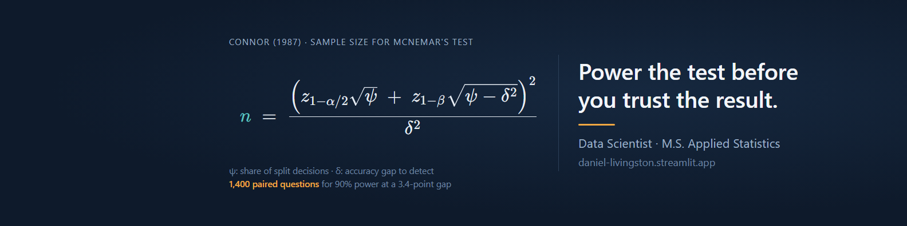

# Daniel Livingston

**Data Scientist · M.S. Applied Statistics · Greer, SC**

Twelve years building, deploying and monitoring production models in finance, energy and industry, most recently as Principal Data Scientist at Diesel Laptops. I design the platform patterns and build on them: Snowflake and Databricks feature stores and semantic layers, forecasts that feed optimizers, and LLM agents with the tests to prove they work.

- **Decisions over metrics.** Models tuned to the business cost of an error, not a leaderboard score.
- **Built to be questioned.** Comparisons sized by a power analysis, intervals on the results, interpretable models, and every agent's numbers checked against its tools.
- **Platforms that scale.** Governed Snowflake and Databricks patterns: isolated schemas with audit logging, feature stores, and champion/challenger promotion.

## Try it live

No sign-in, and nothing you click costs anyone money.

| Demo | What it shows |
|---|---|
| **[Plan an empty-container network](https://daniel-livingston.streamlit.app/container-planner)** | A demand forecast for 15 depots feeds a mixed-integer program that decides which empties to truck where. Change the costs or the forecast's accuracy and watch it re-plan. |
| **[Retrain a crowd forecast](https://park-crowd-forecast.streamlit.app)** | Tune the production LightGBM model, backtest it on years it never saw, and test it against the champion with a block bootstrap, the same gate the weekly Databricks job uses. |
| **[How many questions does a fair test need?](https://daniel-livingston.streamlit.app/power-test)** | The power analysis behind a 1,400-question McNemar comparison of my semantic layer against Snowflake's Cortex Analyst. Analyst won, 93.8% to 87.9%. |
| **[Ask 709 jet engines a question](https://ask-the-fleet.streamlit.app)** | Plain-English questions go to a Databricks Genie space that writes SQL against governed Unity Catalog metric views. Allow a minute on the first question while the warehouse starts. |
| **[Step through an AI agent's tests](https://daniel-livingston.streamlit.app/agent-runs)** | Thirty graded runs of an agent that routes questions to specialists, calls an optimizer, and has every number checked against its tools. Then try to get past its guardrails. |

## Featured projects

**[Crowd Forecast and Staffing Optimizer](https://github.com/livingdw67/park-crowd-forecast)** · [live demo](https://park-crowd-forecast.streamlit.app) 
Forecasts daily crowds at Universal Orlando's parks 90 days out on Databricks and feeds them to a mixed-integer program that plans 14 days of shifts, trading wages against guest wait time. Forecast errors run 12 to 19 points against 17 to 22 for the best simple baseline, and a challenger replaces the champion only if a paired block bootstrap says it's better. A difference-in-differences and synthetic-control study puts Epic Universe's effect on Universal Studios at a 20% to 30% drop in crowds, reported as suggestive: with seven comparison parks, no placebo p-value can go below 1/8. An LLM agent answers questions from the forecast and optimizer, with every number checked against tool output. 
`Databricks` `Unity Catalog` `MLflow` `LightGBM` `Optuna` `OR-Tools MILP` `Synthetic control` `LLM agent`

**[Predictive Maintenance on a Governed Semantic Layer](https://github.com/livingdw67/cmapss-predictive-maintenance)** · [live demo](https://ask-the-fleet.streamlit.app) 
Tandem XGBoost models flag turbofan engines 50 and 15 cycles before failure, catching about 91% of failures on held-out NASA C-MAPSS engines. One Snowflake semantic view feeds a report, Cortex Analyst and an MCP server under a read-only role, with all 80 metrics reconciled against hand-written SQL. Ported to Databricks as a Unity Catalog feature table, MLflow champion models, a Kedro pipeline registered as one model, and the metric views behind the live Genie app. 
`Snowflake` `Semantic views` `MCP` `Databricks` `Unity Catalog` `MLflow` `Kedro` `XGBoost`

**[Tire Industry Report Analyst](https://github.com/livingdw67/michelin-rag)** 
A LangGraph agent that answers questions over 1,250 pages of tire-industry annual reports with page citations. It got 40 of 41 test questions right and refused every off-topic and prompt-injection attempt. 
`LangGraph` `RAG` `FastAPI` `Streamlit` `Docker`

**[Customer Segmentation](https://github.com/livingdw67/snowpark-customer-segmentation)** · [how it was tested](https://daniel-livingston.streamlit.app/power-test) 
Segments 4,261 customers by predicted next-quarter value and buying style, trained inside Snowflake. The top 20% capture 71% of next-quarter revenue, against 56% for standard RFM. Includes Segment Assistant, an LLM chat app for exploring the segments. 
`Snowpark` `scikit-learn` `LangGraph` `Streamlit` `McNemar's test`

**[Automated Root Cause Analysis](https://github.com/livingdw67/semantic-rca)** 
When a KPI drops, it works out why by crawling the dbt Semantic Layer in 8 to 11 warehouse statements, then splits the change across causes with Owen values and bootstrap intervals. On its showcase dataset it finds all four planted incidents with the right mechanism and sign. 
`dbt Semantic Layer` `MetricFlow` `DuckDB` `Owen values`

**[Loan Default Prediction](https://github.com/livingdw67/loan-default-prediction)** 
An ECOA-compliant model with an F2-tuned threshold that catches about 75% of defaults on a true holdout (AUC 0.76), after catching training-data leakage that had inflated the first estimate. Rebuilt on Databricks, where one Optuna-tuned LightGBM matches the three-model ensemble (AUC 0.771 vs 0.762). 
`Azure ML AutoML` `Databricks` `Optuna` `SHAP` `Threshold optimization`

**[Grid Stress Simulator](https://github.com/livingdw67/grid-stress-simulator)** · [live demo](https://grid-stress-simulator.streamlit.app) 
Models how heat pump and EV adoption shift winter peak load across South Carolina counties. An 11 PM EV charging timer would create a new midnight peak above today's morning peak. 
`NREL ResStock` `Streamlit` `Plotly`

## Experience

| Role | Highlights |
|---|---|
| **Diesel Laptops** Principal Data Scientist (contract), 2026 | Deployed a classifier that separates sensor errors from physical coolant leaks, improving the diagnostic product's accuracy by 16%, peer-reviewed graph neural network models, and cut pipeline runtime by 30% under Dagster. |
| **Attain Financial** Contract data scientist, 2026 | Designed a five-schema Snowflake architecture with isolated environments and audit logging, served a collections forecast from the Model Registry, and built a Cortex Analyst semantic layer for finance users. |
| **Duke Energy** Contract data scientist, 2024 to 2025 | Built a centralized feature store across smart meter, program and demographic data, cutting data preparation and model building time by 50%, and introduced control groups for enterprise models. |
| **TIAA**, 2014 to 2023 Senior Data Scientist, 2021 to 2023 Senior Analyst, Customer Insights, 2016 to 2021 | Built the propensity models behind a recommendation system that drove $36M in incremental revenue in six months, an XGBoost churn model with SHAP explanations, and the model monitoring process that became the firm's standard. |

## Toolkit

| Area | Tools and methods |
|---|---|
| **Statistics and experimentation** | Power analysis (Connor's formula for paired tests), A/B tests and control groups, McNemar's test with Newcombe intervals, Wilson intervals, block and cluster bootstrap, difference-in-differences, synthetic control with placebo tests, Owen values |
| **Modeling** | LightGBM, XGBoost, scikit-learn, PyTorch, Optuna, time-series backtests, survival analysis, SHAP |
| **Optimization** | Mixed-integer programming (OR-Tools, HiGHS), forecasts that feed optimizers |
| **Snowflake** | Snowpark, stored procedures, Model Registry, feature stores, Cortex Analyst semantic views, MCP server |
| **Databricks** | PySpark, Delta Lake, Unity Catalog, MLflow, Jobs, Asset Bundles, Apps, Genie |
| **Applied AI** | LLM agents and tool orchestration, RAG with citations, MCP, text-to-SQL over semantic layers, guardrails, LLM evaluation |
| **Engineering** | Python, SQL, Git, pytest, GitHub Actions, Docker, FastAPI, Dagster, Kedro, Azure ML, AWS, SAS, R |
| **Credentials** | M.S. Applied Statistics · AWS Certified Machine Learning – Associate (2024) |
