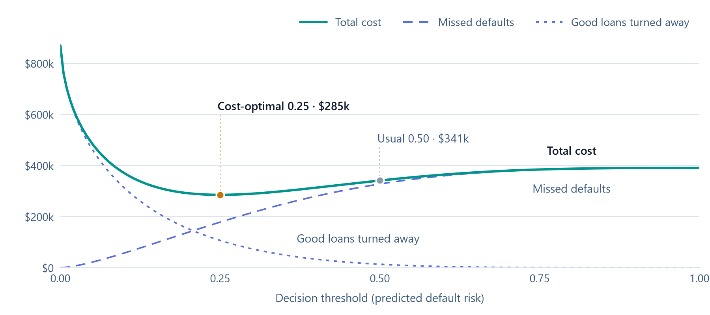

**Daniel Livingston**<br>
Data Scientist, Greer, SC<br>
 

# Models that change the decision.

Twelve years building, deploying and monitoring production models in finance and energy. I design the platform patterns and build on them: Snowflake and Databricks feature stores and semantic layers, forecasts that feed optimizers, and LLM agents with the tests to prove they work.

- **Decisions over metrics.** Models tuned to the business cost of an error, not a leaderboard score.
- **Built to be questioned.** Interpretable models, fair-lending compliance, and every agent's numbers checked against its tools.
- **Platforms that scale.** Governed Snowflake and Databricks patterns: isolated schemas with audit logging, feature stores, and champion/challenger promotion.

[](#try-it)
[](#projects)
[](https://daniel-livingston.streamlit.app)
[](https://www.linkedin.com/in/daniel-w-livingston)

### What a threshold costs

Expected cost of wrong calls on 1,000 loan applications

<picture>
  <source media="(prefers-color-scheme: dark)" srcset="assets/threshold-cost-dark.png">
  
</picture>

Illustrative lending book, scored by a calibrated default model. A missed default loses \$3,000; turning away a good borrower gives up \$1,000 of profit. With calibrated scores the cheapest threshold is

```math
t^{*} = \frac{C_{\text{FP}}}{C_{\text{FP}} + C_{\text{FN}}} = \frac{1{,}000}{1{,}000 + 3{,}000} = 0.25
```

That's not the usual 0.50, which costs \$56k more. The same choice, made on real applicants, is in [Loan Default Prediction](https://github.com/livingdw67/loan-default-prediction).

<details>
<summary>The numbers behind the chart</summary>

| Threshold | Total cost | Missed defaults | Good loans turned away |
|---|---|---|---|
| 0.10 | $370.4k | $57.6k | $312.8k |
| **0.25** | **$285.5k** | **$178.5k** | **$106.9k** |
| 0.50 | $341.4k | $327.8k | $13.6k |
| 0.75 | $384.6k | $384.1k | $0.5k |

Predicted risk follows Beta(0.5, 3.5), a 12.5% default rate. Code: [scripts/make_threshold_chart.py](scripts/make_threshold_chart.py).
</details>

## Try it

Five working demos. No sign-in, and nothing you click costs anyone money.

<table>
<tr>
<td width="50%" valign="top">
<sub>RUNS HERE · SOLVES IN ABOUT A SECOND</sub><br>
<b><a href="https://daniel-livingston.streamlit.app/container-planner">Plan an empty-container network</a></b><br><br>
A demand forecast for 15 depots feeds a mixed-integer program that decides which empties to truck where. Change the costs or the forecast's accuracy and watch it re-plan.<br><br>
<i>Shows: Forecasting into optimization, and what forecast accuracy is worth in dollars.</i>
</td>
<td width="50%" valign="top">
<sub>DATABRICKS PROJECT · FROZEN SNAPSHOT</sub><br>
<b><a href="https://park-crowd-forecast.streamlit.app">Retrain a crowd forecast</a></b><br><br>
Tune the production LightGBM model, backtest it on years it never saw, and test it against the champion with a block bootstrap, the same gate the weekly Databricks job uses.<br><br>
<i>Shows: Champion/challenger promotion and out-of-time validation.</i>
</td>
</tr>
<tr>
<td width="50%" valign="top">
<sub>LIVE ON DATABRICKS · 50 QUESTIONS A DAY</sub><br>
<b><a href="https://ask-the-fleet.streamlit.app">Ask 709 jet engines a question</a></b><br><br>
Plain-English questions go to a Databricks Genie space that writes SQL against governed Unity Catalog metric views of engine reliability. Allow a minute on the first question while the warehouse starts.<br><br>
<i>Shows: Semantic layers, text-to-SQL with guardrails, a public app on a budget.</i>
</td>
<td width="50%" valign="top">
<sub>RUNS HERE · REPLAYS RECORDED RUNS</sub><br>
<b><a href="https://daniel-livingston.streamlit.app/agent-runs">Step through an AI agent's tests</a></b><br><br>
Thirty graded runs of an agent that routes questions to specialists, calls an optimizer, and has every number checked against its tools. Then try to get past its guardrails.<br><br>
<i>Shows: Tool orchestration, failure handling, guardrails and evaluation.</i>
</td>
</tr>
<tr>
<td colspan="2" valign="top">
<sub>RUNS HERE · NO AI MODEL</sub><br>
<b><a href="https://daniel-livingston.streamlit.app/ask">Ask about my work</a></b><br><br>
Pick a question and get the answer in my own words: verbatim quotes from the project write-ups and this page, with the source beside each one.<br><br>
<i>Shows: Grounded answers, and knowing when a model isn't the right tool.</i>
</td>
</tr>
</table>

## Projects

Eight end-to-end builds, each with the data, the model and the decision it supports. Open one to read the full write-up.

<sub>CUSTOMER ANALYTICS · APPLIED AI</sub>
### [Crowd Forecast and Staffing Optimizer](https://github.com/livingdw67/park-crowd-forecast)
Forecasts daily crowds at Universal Orlando's parks 90 days out on Databricks and feeds them to a mixed-integer program (OR-Tools) that plans 14 days of shifts, trading wages against guest wait time. Forecast errors run 12 to 19 points against 17 to 22 for the best simple baseline, and a challenger replaces the champion only if a bootstrap test says it's better. A synthetic-control study suggests Epic Universe cut Universal Studios' crowds by 20% to 30% (suggestive only: with seven comparison parks, no placebo p-value can go below 1/8), and an LLM agent answers questions from the forecast and optimizer, with every number checked against tool output.

`Databricks` `Unity Catalog` `MLflow` `LightGBM` `OR-Tools MILP` `Synthetic control` `LLM agent`<br>
[Live app](https://park-crowd-forecast.streamlit.app) · [Agent test runs](https://daniel-livingston.streamlit.app/agent-runs)

<sub>ENERGY & INDUSTRY · APPLIED AI · ANALYTICS ENGINEERING</sub>
### [Predictive Maintenance on a Governed Semantic Layer](https://github.com/livingdw67/cmapss-predictive-maintenance)
Tandem XGBoost models flag turbofan engines 50 and 15 cycles before failure, catching about 91% of failures on held-out NASA C-MAPSS engines. One Snowflake semantic view feeds a report, Cortex Analyst and an MCP server under a read-only role, with all 80 metrics reconciled against hand-written SQL. Ported to Databricks as a Unity Catalog feature table, MLflow champion models, a Kedro pipeline registered as one model, and the metric views behind the live Genie app.

`Snowflake feature store` `Semantic views` `MCP` `Databricks` `Unity Catalog` `MLflow` `XGBoost`<br>
[Live app](https://ask-the-fleet.streamlit.app)

<sub>APPLIED AI · ENERGY & INDUSTRY</sub>
### [Tire Industry Report Analyst](https://github.com/livingdw67/michelin-rag)
A LangGraph agent that answers questions over 1,250 pages of tire-industry annual reports with page citations. It got 40 of 41 hand-checked questions right and refused every off-topic and prompt-injection attempt. A harder 400-question test, crossing company, question type and wording, scored 82% on its 300 held-out questions, 21 points ahead of the best local model after tuning, and showed where the work is: comparisons and false premises.

`LangGraph` `RAG` `FastAPI` `Streamlit` `Docker`<br>
[How it was tested](https://github.com/livingdw67/michelin-rag/blob/main/eval/factorial/README.md)

<sub>APPLIED AI</sub>
### [Theme Park Event Extraction](https://github.com/livingdw67/theme-park-event-extraction)
Compares a rule-based tagger, zero-shot GLiNER and a fine-tuned DistilBERT for finding parks, attractions, events and dates in text, scored on 150 hand-labeled sentences from Wikipedia articles none of them were built from. Trained on the rules' labels, DistilBERT ties the rules (F1 0.76; on every seed the paired bootstrap interval for the difference runs from −0.04 to +0.04) because it learns to copy them. Zero-shot GLiNER finds 40% of the names the rules can't, at 0.48 precision.

`Hugging Face Transformers` `DistilBERT` `GLiNER` `PyTorch` `Bootstrap intervals`

<sub>CUSTOMER ANALYTICS · APPLIED AI</sub>
### [Customer Segmentation](https://github.com/livingdw67/snowpark-customer-segmentation)
Segments 4,261 customers by predicted next-quarter value and buying style. The top 20% capture 71% of next-quarter revenue, against 56% for standard RFM. Includes Segment Assistant, an LLM chat app for exploring the segments.

`Snowpark` `scikit-learn` `LangGraph` `Streamlit`<br>
[How it was tested](https://daniel-livingston.streamlit.app/power-test)

<sub>ANALYTICS ENGINEERING · CUSTOMER ANALYTICS</sub>
### [Automated Root Cause Analysis](https://github.com/livingdw67/semantic-rca)
When a KPI drops, it works out why by crawling the dbt Semantic Layer in 8 to 11 warehouse statements, then splits the change across causes with Owen values and bootstrap intervals. On its showcase dataset it finds all four planted incidents with the right mechanism and sign. A benchmark over randomly planted incidents now scores recall and precision across many datasets, and is guiding the next round of improvements.

`dbt Semantic Layer` `MetricFlow` `DuckDB` `Owen values` `Forecasting`

<sub>FINANCE</sub>
### [Loan Default Prediction](https://github.com/livingdw67/loan-default-prediction)
An ECOA-compliant model with an F2-tuned threshold that catches about 75% of defaults on a true holdout (AUC 0.76). Along the way it caught training-data leakage that had inflated the first estimate. It was rebuilt on Databricks, where one Optuna-tuned LightGBM matches the three-model ensemble (AUC 0.771 vs 0.762).

`Azure ML AutoML` `Databricks` `Optuna` `SHAP` `Threshold optimization`

<sub>ENERGY & INDUSTRY</sub>
### [Grid Stress Simulator](https://github.com/livingdw67/grid-stress-simulator)
Models how heat pump and EV adoption shift winter peak load across South Carolina counties. An 11 PM EV charging timer would create a new midnight peak above today's morning peak.

`NREL ResStock` `Streamlit` `Plotly`<br>
[Live app](https://grid-stress-simulator.streamlit.app)

## Experience

Production models in finance and a utility, measured in revenue and hours saved.

**2026 · Attain Financial**<br>
<sub>Contract data scientist</sub><br>
Designed a five-schema Snowflake architecture with isolated environments and audit logging, served a collections forecast from the Model Registry, and built a Cortex Analyst semantic layer for finance users.

**2024 to 2025 · Duke Energy**<br>
<sub>Contract data scientist</sub><br>
Built a centralized feature store across smart meter, program and demographic data, cutting data preparation and model building time by 50%, and introduced control groups for enterprise models.

**2014 to 2023 · TIAA**<br>
<sub>Senior Data Scientist, 2021 to 2023 · Senior Analyst, Customer Insights, 2016 to 2021</sub><br>
Built the propensity models behind a recommendation system that drove $36M in incremental revenue in six months, an XGBoost churn model with SHAP explanations, and the model monitoring process that became the firm's standard.

## Toolkit

| Area | Tools and methods |
|---|---|
| **Snowflake** | Snowpark, stored procedures, Model Registry, feature stores, Cortex Analyst semantic views, MCP server |
| **Databricks** | PySpark, Delta Lake, Unity Catalog, MLflow, Jobs, Asset Bundles, Apps, Genie |
| **Modeling** | LightGBM, XGBoost, scikit-learn, PyTorch, Hugging Face Transformers, Optuna, time-series backtests, survival analysis, SHAP |
| **Statistics and causal inference** | Power analysis, A/B tests and control groups, McNemar's test with Newcombe intervals, Wilson intervals, block and cluster bootstrap, difference-in-differences, synthetic control with placebo tests, Owen values |
| **Optimization** | Mixed-integer programming (OR-Tools, HiGHS), threshold optimization |
| **Applied AI** | LLM agents and tool orchestration, RAG with citations, MCP, text-to-SQL over semantic layers, named-entity recognition (fine-tuned DistilBERT, zero-shot GLiNER), guardrails, LLM evaluation |
| **Engineering** | Python, SQL, Git, pytest, GitHub Actions, Docker, FastAPI, Kedro, Azure ML, AWS, SAS, R |
| **Credentials** | M.S. Applied Statistics. AWS Certified Machine Learning, Associate (2024) |
